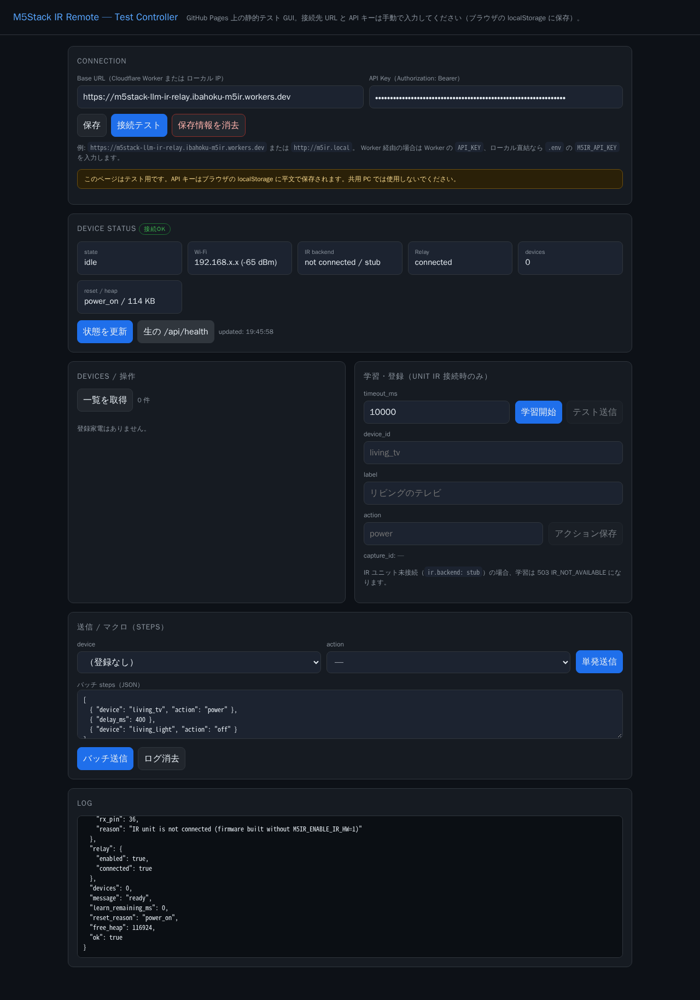

# m5stack-llm-ir

M5Stack と **M5Stack Unit IR (U002)** を使い、宅外の LLM エージェント（Hermes Agent / Muse など）から
HTTP API 経由で赤外線家電を操作・学習・管理する OSS スマートリモコンの MVP 実装です。

本リポジトリは共有された仕様書 **v0.2.0-draft（2026-11-25）** に基づいて実装しています。
仕様書のローカルコピーは [`spec/SPEC.md`](spec/SPEC.md) にあります（取得元:
<https://share.gemini.google/QzSq4mluA4t0>）。

---

## 現在の実装状況

| 項目 | 状態 |
| --- | --- |
| 仕様書のローカル保存 | 完了（`spec/SPEC.md`、原文 HTML は `spec/raw/`） |
| ファームウェア本体（Wi-Fi / mDNS / HTTP API / LittleFS / LCD / 状態機械） | 実装済み・全 4 ボードでビルド成功 |
| 赤外線エンジン（IRremoteESP8266 2.9.0） | 実装済み・`-ir` 環境でビルド成功（**実機の Unit IR は未接続**） |
| Cloudflare Workers 逆トンネル中継（`relay/`） | 実装済み・ローカル E2E テスト 26/26 成功 |
| LLM エージェント向けスキル（`skill/SKILL.md`） | 実装済み |
| M5Stack 実機への書き込み・起動確認 | **完了**: M5Stack Core（初代 Basic/Gray, ESP32-D0WDQ6-V3, 16MB）を USB 検出・書き込み・起動確認済み |
| Wi-Fi 接続・HTTP API の実機確認 | **完了**: `http://m5ir.local` で health / devices / 401 / 503(IR) を確認、`tools/smoke_test.py` ALL PASS |

### 赤外線ユニット未到着への対応

Unit IR がまだ届いていないため、デフォルトのビルド環境は **スタブ IR バックエンド**で動作します。

* `POST /api/ir/learn`・`POST /api/ir/test`・`POST /api/ir/send` は即座に
  `503 IR_NOT_AVAILABLE` を返します。
* それ以外（`GET /api/health`、`GET /api/devices`、家電・アクションの永続保存、削除、
  LCD 表示、リレー接続）はすべて実機で動作します。
* Unit IR が届いたら、`platformio.ini` の `-ir` 環境（例: `m5stack-cores3-ir`）で
  ビルドし直すだけで、IRremoteESP8266 による送受信コードが有効になります。
  配線・ピンの詳細は [`docs/hardware.md`](docs/hardware.md) を参照してください。

---

## リポジトリ構成

```
.
├── .env.example              # Wi-Fi / API キー / リレー設定の雛形（.env にコピー）
├── firmware/                 # PlatformIO プロジェクト（M5Stack 用 C++）
│   ├── platformio.ini        # 機種別ビルド環境（cores3 / core2 / stickc-plus2 / atoms3）
│   ├── extra_script.py       # ルートの .env から secrets_generated.h を生成する pre スクリプト
│   ├── include/
│   │   └── config.h          # ビルド時設定・API 制限値・ピン既定値
│   └── src/
│       ├── main.cpp          # Wi-Fi・mDNS・LCD・起動処理
│       ├── api_handler.cpp   # HTTP / WebSocket 共通の JSON コマンド処理層
│       ├── http_server.cpp   # ローカル HTTP ルーティング（非同期ハンドラ）
│       ├── relay_ws.cpp      # Cloudflare Workers 向け WSS 逆トンネルクライアント
│       ├── ir_engine.cpp     # IRremoteESP8266 送受信（スタブ / 実機の2モード）
│       ├── storage.cpp       # LittleFS JSON 読み書き（アトミック保存）
│       ├── state.cpp         # デバイス DB・キャプチャ・状態機械（排他制御）
│       └── lcd_ui.cpp        # LCD フィードバック
├── relay/                    # Cloudflare Workers + Durable Objects 中継（任意）
│   ├── wrangler.toml
│   └── src/index.ts
├── skill/
│   └── SKILL.md              # LLM エージェント用スキル定義
├── docs/
│   ├── api.md                # API リファレンス・curl サンプル
│   ├── hardware.md           # 対応ハードウェア・Grove 配線・ピン一覧
│   └── remote-access.md      # Workers 逆トンネル / Tailscale / Cloudflare Tunnel
├── tools/
│   └── smoke_test.py         # 実機/リレー向け API スモークテスト（stdlib のみ）
├── spec/                     # 仕様書のローカルコピー（SPEC.md）
└── README.md
```

---

## クイックスタート（ファームウェア）

### 1. ツールの準備

```bash
python3 -m venv .venv
.venv/bin/pip install platformio
```

### 2. シークレット設定（`.env`）

Wi-Fi パスワードなどのシークレットは、リポジトリ直下の `.env` に書きます
（`firmware/extra_script.py` がビルド時に `firmware/include/secrets_generated.h` を生成して埋め込みます）。

```bash
cp .env.example .env
# .env を編集
#   WIFI_SSID=...
#   WIFI_PASSWORD=...
#   M5IR_API_KEY=...   # 32文字以上推奨: openssl rand -hex 32
```

`.env` は `.gitignore` 済みで、リポジトリにはコミットされません。
ファイルを置くのはプロジェクトルート（`firmware/` の 1 つ上）です。

### 3. ビルドと書き込み

```bash
cd firmware
# CoreS3（IR ユニット未接続・スタブ動作）
../.venv/bin/pio run -e m5stack-cores3 -t upload

# ログ確認
../.venv/bin/pio device monitor
```

| 環境 | ボード | 用途 |
| --- | --- | --- |
| `m5stack-cores3` | M5Stack CoreS3 | 既定（スタブ IR） |
| `m5stack-core2` | M5Stack Core2 | スタブ IR |
| `m5stack-stickc-plus2` | M5StickC Plus2 | スタブ IR |
| `m5stack-atoms3` | M5Stack AtomS3 | スタブ IR |
| `m5stack-core16m` | M5Stack Core（初代 Basic/Gray, 16MB） | スタブ IR（実機で確認済み） |
| `m5stack-core16m-test` | 同上 | **API ライフサイクル試験用**（合成 IR バックエンド。本番使用禁止） |

> 実機は `m5stack-core16m`（Unit IR スタブ + Cloudflare リレー有効）で稼働確認済みです。
| `m5stack-cores3-ir` など `-ir` 付き | 各ボード | **Unit IR 接続後**（IR 実機動作） |

書き込みポートは自動検出されます。検出されない場合は `-t upload --upload-port /dev/ttyACM0`
（CoreS3/AtomS3）や `/dev/ttyUSB0`（Core2/StickC Plus2、CP210x/CH9102 ドライバ）を指定してください。

### 4. 動作確認

```bash
# API キーなしで疎通確認（/api/health は認証不要）
curl -s http://m5ir.local/api/health | python3 -m json.tool

# 認証が必要な API
curl -s -H "Authorization: Bearer $M5IR_API_KEY" http://m5ir.local/api/devices
```

詳しい API は [`docs/api.md`](docs/api.md) を参照してください。

---

## 検証結果

このリポジトリでは以下を実際に実行して確認済みです。

```bash
# ファームウェア: 全ボードのスタブビルド + CoreS3 の IR 有効ビルド
cd firmware
../.venv/bin/pio run -e m5stack-cores3        # SUCCESS
../.venv/bin/pio run -e m5stack-cores3-ir     # SUCCESS (IRremoteESP8266 2.9.0)
../.venv/bin/pio run -e m5stack-core2 -e m5stack-stickc-plus2 -e m5stack-atoms3
                                              # 3/3 SUCCESS

# リレー: TypeScript 型チェック + ローカル E2E（wrangler dev + 擬似 M5Stack）
cd relay
npx tsc --noEmit                              # exit 0
npm test                                      # 26/26 checks passed
```

### 実機での確認（M5Stack Core 初代）

USB シリアル（CH9102F, `/dev/ttyACM0`）経由で `m5stack-core16m` を書き込み、
ボード検出・Wi-Fi 接続・HTTP API まで実機で確認済みです。

- チップ: `ESP32-D0WDQ6-V3 (revision v3.0)` / 16MB flash / MAC `xx:xx:xx:xx:xx:xx`（伏字）
- M5GFX ボード検出: `board=1`（`board_M5Stack` = 初代 Core Basic/Gray）/ `display=320x240`
- Wi-Fi 接続後: `http://m5ir.local`（検証時 DHCP で `192.168.x.x`）で受付
- `GET /api/health` → `ok:true`、`ir.hardware:false`（Unit IR 未接続）
- 認証なし `GET /api/devices` → `401 UNAUTHORIZED`、API キー付き → `{"ok":true,"devices":{}}`
- `POST /api/ir/learn` → `503 IR_NOT_AVAILABLE`（スタブ IR の想定どおり）
- `python3 tools/smoke_test.py --base-url http://m5ir.local --api-key ...` → **ALL CHECKS PASSED**

### クラウド（Cloudflare + GitHub Pages）の確認

* `wrangler deploy` → `https://m5stack-llm-ir-relay.ibahoku-m5ir.workers.dev`
* `GET <worker>/health` → `{"ok":true,"worker":true,"device_online":true}`
* `GET <worker>/api/health`（Bearer 認証）→ M5Stack のヘルス JSON が返却
* 認証なし `/api/*` → 401、CORS プリフライト → 204 + `Access-Control-Allow-Origin: *`
* GitHub Actions で Pages デプロイ成功 → `https://iba-hok.github.io/m5stack-llm-ir/`
* Playwright による GUI E2E: **PASS**（接続・家電一覧・生 health、ブラウザエラー 0）
* スキル検証: 会話コンテキストなしの新規サブエージェント 3 回（`fake` / `stub` バックエンド）で
  [`skill/SKILL.md`](skill/SKILL.md) のみから正しく操作できることを確認
  → 詳細は [docs/skill-validation.md](docs/skill-validation.md)

起動ログの例:

```
[boot] M5Stack LLM IR remote v0.1.0
[boot] display=320x240 board=1
[storage] LittleFS mounted: 8192/3538944 bytes used
[ir] stub backend: IR unit is not connected
[net] Wi-Fi connected: ssid=<your-ssid> ip=192.168.x.x rssi=-58
[net] mDNS: http://m5ir.local/
[http] listening on port 80
[relay] disabled (RELAY_WS_URL is empty)
```

> 実機のボード検出が `board=1`（初代 M5Stack Core）だったため、書き込み環境を
> `m5stack-core16m`（ESP32 / 16MB / Unit IR は M5-Bus G26/G36）として追加しています。
> Unit IR 到着後は `m5stack-core16m-ir` で書き込み直してください。

### API ライフサイクル試験（合成 IR バックエンド）

Unit IR 未接続でも家電の追加・削除・永続化を検証できるよう、`-test` 環境
（`M5IR_FAKE_IR_BACKEND=1`）を追加しました。実機（初代 Core）で以下を確認済みです。

| 手順 | 結果 |
| --- | --- |
| `POST /api/ir/learn`（合成 NEC 信号） | 200 / `protocol=NEC, bits=32, raw_length=67` |
| `POST /api/ir/test` | 200 / `sent=true` |
| `POST /api/devices/test_tv/actions`（power / vol_up） | 201 ×2 |
| `GET /api/devices` | `test_tv` と 2 アクションを表示 |
| `POST /api/ir/send`（単発 / 3 ステップバッチ） | `executed_steps=1` / `3` |
| 再起動後の `GET /api/devices` | 登録内容が LittleFS から復元 |
| `DELETE .../actions/vol_up` | 200 / power のみ残る |
| `DELETE /api/devices/test_tv` | 200 / 一覧が空 |
| 再度再起動後の `GET /api/devices` | 空のまま（削除も永続化） |

```bash
# 試験用ビルド（本番では使わない）
tools/flash.sh m5stack-core16m-test
```

`GET /api/health` の `ir.backend` が `fake` なら合成バックエンド、`stub` なら
Unit IR 未接続のスタブ、`irremote` なら実機 IR です。

```bash
python3 tools/smoke_test.py --base-url http://m5ir.local --api-key "$M5IR_API_KEY"
# Unit IR 未接続（スタブ）の間は IR チェックを自動スキップ
```

## 赤外線ユニット到着後の手順

1. Unit IR (U002) の Grove ケーブルを、お使いの機種の **PORT.B（黒）** または GPIO 兼用ポートへ接続
   （CoreS3: G9/G8、Core2: G26/G36、M5StickC Plus2: G32/G33、AtomS3: G2/G1）。
   ピン番号は `firmware/platformio.ini` の `M5IR_IR_TX_PIN` / `M5IR_IR_RX_PIN` で変更できます。

   > **初代 M5Stack Core（Basic / Gray）の場合**: 本体の Grove は赤い PORT.A（I2C: G21/G22）のみで、
   > Unit IR をそのまま挿せません（仕様 3.2）。M5-Bus の **G26（黄=IR_TX）/ G36（白=IR_RX）** へ
   > ジャンパ線で接続するか、Port B 付きのベース拡張を使用してください。
   > 本リポジトリの初期化（`m5stack-core16m` / `m5stack-core16m-ir`）はこの G26/G36 を既定にしています。
2. `-ir` 環境でビルド＆書き込み:

   ```bash
   ../.venv/bin/pio run -e m5stack-cores3-ir -t upload
   ```

3. `GET /api/health` の `ir.hardware` が `true` になることを確認。
4. LLM エージェントから [`skill/SKILL.md`](skill/SKILL.md) の手順で家電を学習・登録。

---

## デプロイ情報（このリポジトリの実例）

| 項目 | URL / 状態 |
| --- | --- |
| Cloudflare Worker（リレー） | <https://m5stack-llm-ir-relay.ibahoku-m5ir.workers.dev> |
| テスト GUI（GitHub Pages） | <https://iba-hok.github.io/m5stack-llm-ir/> |
| M5Stack 実機 | 初代 M5Stack Core（`m5stack-core16m`） |

### Cloudflare リレーのデプロイ（実行済み）

```bash
cd relay
npx wrangler login
npx wrangler deploy          # https://m5stack-llm-ir-relay.<subdomain>.workers.dev
npx wrangler secret put API_KEY
npx wrangler secret put DEVICE_TOKEN
```

* `API_KEY` はエージェント用（`.env` の `M5IR_API_KEY` と同じ値）
* `DEVICE_TOKEN` は M5Stack 用（`.env` の `DEVICE_TOKEN` と同じ値）
* M5Stack 側は `.env` の `RELAY_WS_URL` に `wss://<worker>/ws/device` を設定して書き込み

### テスト GUI（GitHub Pages）

静的ページのみで、**接続先 URL と API キーは画面上で手動入力**します
（ブラウザの localStorage に保存。リポジトリには一切埋め込みません）。

```
https://iba-hok.github.io/m5stack-llm-ir/
```

1. Base URL に Worker の URL（例: `https://m5stack-llm-ir-relay.ibahoku-m5ir.workers.dev`）
   または `http://m5ir.local` を入力
2. API Key を入力して「接続テスト」
3. 家電一覧の取得、アクション送信、マクロ（`steps`）送信、学習〜登録（Unit IR 接続時）が可能

CORS は Worker 側で許可済みです（`OPTIONS` プリフライト + `Access-Control-Allow-Origin: *`）。



ヘッドレス Chromium（Playwright）で「GitHub Pages → Cloudflare Worker → M5Stack」の
実通信を E2E 確認済みです（接続テスト・家電一覧取得・生 `/api/health` 取得、ブラウザエラーなし）。
スクリーンショットは LAN 内 IP を伏字化しています。

### 外部アクセス確認（実測）

家庭内 LAN の外にある LLM エージェントを想定し、Cloudflare Worker の公開 URL 経由で
M5Stack の API に到達できることを確認済みです。

```bash
WORKER=https://m5stack-llm-ir-relay.ibahoku-m5ir.workers.dev

curl -s $WORKER/health
# {"ok":true,"worker":true,"device_online":true}       <- M5Stack が WSS で接続中

curl -s -H "Authorization: Bearer $M5IR_API_KEY" $WORKER/api/health
# M5Stack のヘルス JSON（relay.enabled=true / relay.connected=true）

curl -s -o /dev/null -w "%{http_code}\n" $WORKER/api/devices
# 401（API キーなし）
```

* M5Stack は Wi-Fi 接続後に `wss://<worker>/ws/device` へ外向き接続し、
  Cloudflare 側の Durable Object が単一ソケットを保持します。
* 実機は NTP で時刻同期してから WSS 接続します（Cloudflare の TLS 証明書検証のため）。
* ブラウザ（GitHub Pages）からのクロスオリジン呼び出しも CORS プリフライト込みで確認済み。

## 宅外アクセス（オプション）

3 方式をサポートしています。エージェントから見た API パスと JSON は完全に同一です。

1. **Cloudflare Workers + Durable Objects（WebSocket 逆トンネル）** — 自宅 PC 不要で M5Stack 単体運用。
   `relay/` をデプロイし、`.env` の `RELAY_WS_URL` / `DEVICE_TOKEN` を設定。
2. **Tailscale（Subnet Router）** — 閉域 VPN 経由でローカル IP に直接到達。
3. **Cloudflare Tunnel** — 既存の自宅サーバー構成に載せる場合。

手順は [`docs/remote-access.md`](docs/remote-access.md)、リレー実装は [`relay/README.md`](relay/README.md) を参照してください。

---

## 設計メモ

* **責務分離**: `api_handler.cpp` が HTTP / WebSocket 共通のコマンド実行層で、
  ローカル HTTP (`http_server.cpp`) と逆トンネル (`relay_ws.cpp`) は同じロジックを共有します。
* **排他制御**: 学習中（`LEARNING`）は他の `learn` / `send` に `409 Conflict` を返します。
  HTTP は ESP-IDF の非同期ハンドラ + リクエスト毎タスクで処理するため、学習のブロッキング中も
  他リクエスト（`GET /api/health` 等）が応答できます。
* **学習タイムアウト**: `POST /api/ir/learn` は既定 10 秒・上限 30 秒。タイムアウト時は `408`。
* **データ永続化**: `/ir_db.json` へアトミック保存（`/ir_db.tmp` → rename、失敗時は `/ir_db.bak` から復旧）。
  既知プロトコルは `format: "protocol"`、未知プロトコルは `format: "raw"`（µs 配列）で保存。
* **キャプチャ保持**: 学習した波形は RAM に最新 3 件・10 分間だけ保持（再起動で消える）。
* **セキュリティ**: `GET /api/health` 以外は `Authorization: Bearer <API_KEY>` 必須。
  API キー未設定時は認証系エンドポイントが `503 CONFIG_MISSING` を返します。

---

## 仕様との対応

| 仕様セクション | 実装 |
| --- | --- |
| 3. ハードウェア要件・ピン | `firmware/platformio.ini`, `docs/hardware.md` |
| 4.1 認証 / mDNS | `http_server.cpp`, `main.cpp` |
| 4.3 ガードレール（上限値） | `api_handler.cpp` |
| 5. HTTP API v1 | `api_handler.cpp`, `docs/api.md` |
| 6. Cloudflare 逆トンネル | `relay/src/index.ts`, `relay_ws.cpp` |
| 7. データモデル / 永続化 | `storage.cpp`, `state.cpp` |
| 8. LCD・状態遷移 | `lcd_ui.cpp`, `state.cpp` |
| 9. エージェントスキル | `skill/SKILL.md` |

## ロードマップ（仕様 10 章）

* v0.2: Captive Portal によるスマホ初期設定 UI
* v0.3: エアコン向けパラメータ制御（温度・運転モード）
* v0.4: Home Assistant REST API 互換エンドポイント、他 M5 Unit 対応、カスタム統合
